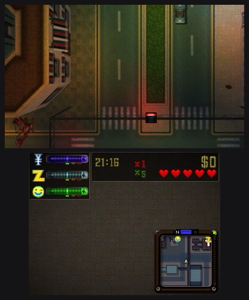
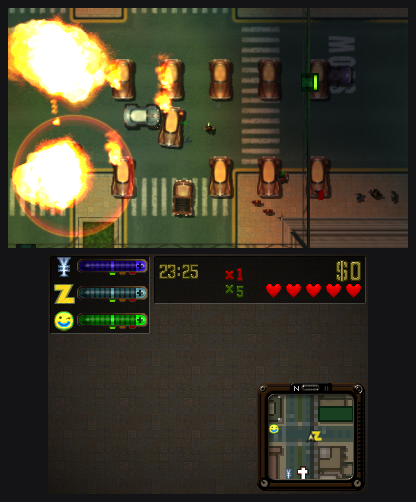
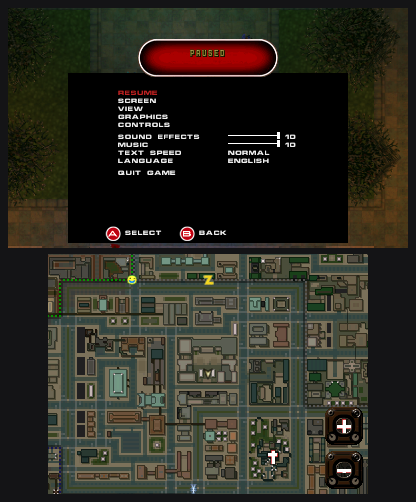

  <picture>
    <source media="(prefers-color-scheme: dark)" srcset="docs/images/reg2_logo_black.svg">
    
  </picture>

# reG2 3DS

GTA2 running natively on the Nintendo 3DS.

> [!WARNING]
> **This is a beta.** Expect bugs, and please report them. No multiplayer.

It's a port of [reG2](https://github.com/reG2-project/reG2), itself a fork of
[gta2_re](https://github.com/CriminalRETeam/gta2_re) by the CriminalRETeam. The credit for the game itself
goes to them: they rebuilt GTA2 (PC, version 10.5) function by function, in C++ that compiles back to the
original machine code. This port adds the 3DS side: rendering, sound, both screens and the controls.

You need your own copy of GTA2 for PC. The free 2004 release works.

## How it runs

All three cities play. On an Old 3DS it holds about 30 fps when driving, with some slowdown in big
explosion chains. The New 3DS works in an emulator but hasn't been tried on real hardware yet.

## Download

| System | Download |
|---|---|
|  Nintendo 3DS (homebrew) | [reg2.3dsx](https://github.com/reG2-project/reG2-3DS/releases/latest/download/reg2.3dsx) for the Homebrew Launcher, or [reg2.cia](https://github.com/reG2-project/reG2-3DS/releases/latest/download/reg2.cia) for the HOME menu |

All releases are on the [releases page](https://github.com/reG2-project/reG2-3DS/releases). For Windows,
Linux and macOS, see [reG2](https://github.com/reG2-project/reG2).

## Install

1. Copy the `data` folder of your GTA2 install to `/3ds/gta2/data` on the SD card.
2. Then either copy `reg2.3dsx` to `/3ds/` and start it from the Homebrew Launcher, or install
   `reg2.cia` with FBI to get an icon on the HOME menu.

You need a 3DS with custom firmware ([3ds.hacks.guide](https://3ds.hacks.guide/)). On Linux,
[`extract_gta2.sh`](port/tools/extract_gta2.sh) pulls the `data` folder out of the free installer without
running it.

Settings, saves and a log (`gta2_log.txt`) end up in `/3ds/gta2/`.

## What's different

The game itself plays like the original. The changes are about the screens and the controls:

- the game on the top screen at the 3DS's resolution, the HUD and a minimap on the bottom one
- the minimap shows territories, phones and the church; two lamps on its frame show whose turf you're in
  and whether that gang is hostile
- the pause menu has the city map, which you can drag and zoom with the stylus
- the 3D slider works

Off unless you turn them on: SHOW FPS, and FRAME LIMIT 60 (New 3DS only).

 

## Controls

Three styles in OPTIONS > CONTROLS: MODERN (default), CLASSIC (the original's tank controls on the circle
pad) and CLASSIC D-PAD.

| Button | On foot | In a vehicle |
|---|---|---|
| Circle pad | walk | steer |
| R | attack | accelerate |
| L | keep facing | brake, reverse |
| B | jump | handbrake |
| A | get in | get out |
| Y, X | previous, next weapon | previous, next weapon |
| D-pad | specials | specials, roof gun |
| START | pause | pause |
| SELECT | back in menus | next radio station |
| C-stick, ZR (New 3DS) | aim, attack | roof gun, attack |

## Not there yet

- intro movies (no Bink decoder on the 3DS)
- multiplayer
- testing on a real New 3DS

## Building

devkitARM with clang, in the official devkitPro Docker image. Details in
[`port/docs/3ds.md`](port/docs/3ds.md).

## Credits

- [gta2_re](https://github.com/CriminalRETeam/gta2_re) and everyone who worked on it.
- [SDL3](https://libsdl.org), [libctru and citro3d](https://github.com/devkitPro), devkitARM.
- [OpenDSP](https://github.com/Cellenseres/OpenDSP) (BSD-2), so you don't need a DSP firmware dump.
- The logo uses the [Michroma](https://github.com/googlefonts/Michroma-font) font (OFL).

Grand Theft Auto and GTA2 are trademarks of Take-Two Interactive. Not affiliated with Rockstar Games or
Take-Two. No game data included.
